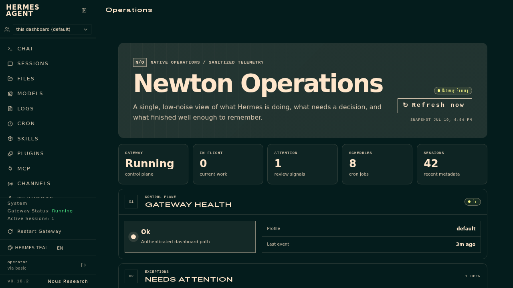

# Newton Operations for Hermes Agent

[](https://github.com/macdoctor-ca/hermes-newton-operations/actions/workflows/ci.yml)
[](LICENSE)

A calm, profile-scoped operations dashboard for [Hermes Agent](https://github.com/NousResearch/hermes-agent). It adds authenticated operational visibility and a small, bounded decision journal without introducing another agent runtime, scheduler, memory system, or source of truth.

> Third-party community plugin. Not affiliated with or endorsed by Nous Research.



## Features

- Native dashboard page at `/operations`
- Canonical gateway liveness plus channel connection state
- Bounded summaries of sessions, Kanban work, cron jobs, delegated agents, and background processes
- Attention feed for degraded sources, disconnected channels, blocked work, and failed jobs
- Append-only decision/outcome journal with deterministic sealing
- Profile-safe lifecycle markers for Kanban and approval outcomes
- Responsive Hermes Teal interface with no external frontend dependencies
- No standalone server, extra listener, model-context injection, or telemetry service

## Security model

Newton Operations is mounted by Hermes's authenticated dashboard server. It does not open a port of its own or contact external services.

Native Hermes sources are read-only. The plugin deliberately excludes message bodies, prompts, commands, raw errors, working directories, credentials, and chat/user identifiers from API responses. It never scans sibling profile directories.

The only writable state is the plugin-owned journal:

- `data/operations.db`
- 2,000-record maximum
- 365-day retention, pruned transactionally on append
- append-only event history with derived projections
- `0600` database and sidecar permissions on POSIX
- `0700` plugin/data directories on POSIX

Lifecycle markers use a bounded daemon queue and are accepted only when the event profile matches the plugin installation profile. Ambiguous or secondary-profile events are dropped.

See [SECURITY.md](SECURITY.md) for the complete boundary and disclosure guidance.

## Requirements

- Hermes Agent **0.18.2 or newer**
- Dashboard authentication configured when exposed beyond loopback
- Python 3.11 or newer

Version `1.0.1` is tested against Hermes Agent `0.18.2` (`2026.7.7.2`). Newton Operations reads native Hermes schemas, so compatibility is validated in CI and should be rechecked after major Hermes upgrades.

## Install

```bash
hermes plugins install macdoctor-ca/hermes-newton-operations --enable
```

Restart the dashboard process using the service manager for your installation, then open:

```text
http://YOUR-HERMES-HOST:9119/operations
```

Lifecycle hooks load with the Hermes gateway. Restart the gateway once after first installation if you want automatic Kanban and approval markers.

### Docker with s6-overlay

The published Hermes Docker image supervises dashboard and gateway processes separately. Restart only what changed:

```bash
# Load dashboard/API assets
docker exec Hermes-Agent \
  /package/admin/s6/command/s6-svc -k /run/service/dashboard

# Optional: load lifecycle hooks now instead of waiting for a normal restart
docker exec Hermes-Agent \
  /package/admin/s6/command/s6-svc -t /run/service/gateway-default
```

The dashboard restart does not interrupt messaging channels. The gateway restart briefly reconnects configured messaging platforms.

## Update

```bash
hermes plugins update newton-operations
```

Restart the dashboard process after updating. Restart the gateway only when hook code or `plugin.yaml` changed.

## Disable or remove

```bash
# Preserve plugin files and journal data
hermes plugins disable newton-operations

# Remove the installed plugin
hermes plugins remove newton-operations
```

Back up `data/operations.db` before removal if you want to preserve journal records.

## Data sources

All operational authority remains with Hermes:

- `gateway_state.json` plus Hermes's canonical runtime lock/PID verifier
- `state.db` for sessions and durable async delegations
- `processes.json` for bounded background-process metadata
- `cron/jobs.json` and `cron/executions.db`
- `kanban.db`

The dashboard aggregates these sources independently. One missing, locked, malformed, or schema-drifted source degrades only its own panel.

## Development

Install [uv](https://docs.astral.sh/uv/), then run the complete quality gate:

```bash
uv sync --group dev
uv run pytest -q
uv run ruff check __init__.py newton_ops_store.py dashboard/plugin_api.py tests
uv run bandit -q -r __init__.py newton_ops_store.py dashboard/plugin_api.py
node --check dashboard/dist/index.js
```

The test suite uses disposable Hermes homes and never touches live operational stores.

## Architecture

- `dashboard/plugin_api.py` — authenticated, bounded read model and journal API
- `dashboard/dist/` — dependency-free dashboard bundle and styles
- `newton_ops_store.py` — append-only SQLite journal, retention, projection, and sealing
- `__init__.py` — nonblocking, profile-scoped lifecycle hooks
- `plugin.yaml` — Hermes plugin manifest
- `dashboard/manifest.json` — native dashboard registration

Additional design and threat-model details are in [DESIGN.md](DESIGN.md) and [SECURITY.md](SECURITY.md).

## License

[MIT](LICENSE)
